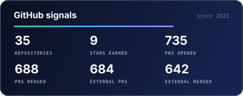
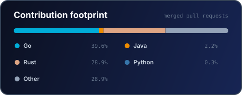

 
 

  
  
  
  
  

---

## 🚀 核心作品与开源生态

<table>
  <tr>
    <td width="50%" valign="top">
      <h3>⚡ <a href="https://github.com/1lck/Lithe-IDEA">Lithe-IDEA</a> &amp; 插件生态</h3>
      

        
        
        
      

      

        面向 AI 时代的超轻量、低延迟、可插拔跨平台原生 IDE。基于 <strong>Viva (Go 原生工作台) + Rust Core</strong> 实现 <strong>&lt;1s 冷启动</strong> 与 <strong>171 MB 稳态内存</strong>，按需加载 LSP、构建工具与调试器。
      

      

        <a href="https://lithe.top">官网</a> ·
        <a href="https://github.com/Lithe-IDEA/Lithe-core-rust">Lithe-core-rust</a> ·
        <a href="https://github.com/Lithe-IDEA/Lithe-store">Lithe-store</a>
      

    </td>
    <td width="50%" valign="top">
      <h3>🎨 <a href="https://github.com/vivaui/viva">Viva</a></h3>
      

        
        
        
      

      

        Go-first、GPU 原生跨平台桌面框架。直连系统底层窗口与图形接口（<strong>Cocoa / Metal</strong>、<strong>Win32 / Direct3D 11</strong>、<strong>XCB / Vulkan</strong>），无 WebView、无内置浏览器运行时，追求极小二进制与极致帧率响应。
      

      

        <a href="https://github.com/vivaui/viva">GitHub 仓库</a> · <a href="https://vivaui.dev/zh/">官网与文档</a>
      

    </td>
  </tr>
</table>

---

## 🛠️ 技术栈

| 领域 | 技术与工具 |
| :--- | :--- |
| **主力语言** |     |
| **原生桌面与研发工具** |    |
| **后端、数据与 AI 工程** |      |

---

## 📊 GitHub 数据概览

 

  

